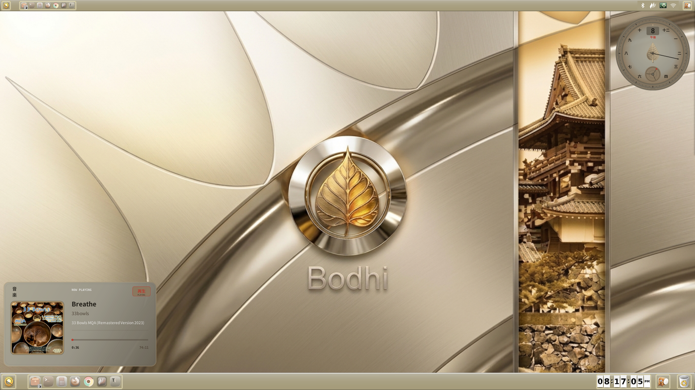

# Japan — Bodhi Desktop Collection

A small desktop collection for Bodhi Linux / Moksha: five `.jpg` wallpapers with five matching `.edj` variants, and four Lua/Cairo Conky configs — a dark Jump Hour clock, a light clock, a dark Pianobar panel, and a light Pianobar panel.

This is **not a new Moksha theme**. Nothing here replaces or modifies an existing theme. The wallpapers and Conkys are meant to be mixed with the Moksha categories you already like.

## What is included

- `japan_dark/japan_dark_jump_clock/` — dark Jump Hour clock (`top_right`).
- `japan_light/japan_light_clock/` — light clock (`top_right`).
- `japan_dark/japan_dark_pianobar/` — dark now-playing panel (`bottom_left`).
- `japan_light/japan_light_pianobar/` — light now-playing panel (`middle_left`).
- `wallpapers/` — five `.jpg` wallpapers and matching `.edj` variants.
- `screenshots/` — full-resolution desktop examples.

Use one clock config and one Pianobar config at a time. The wrapper can start all four for a quick check, but the two clocks and two players intentionally share overlapping desktop positions.

## Requirements

- Conky 1.12.2 with Lua/Cairo support (`conky-all` on Debian/Ubuntu/Mint).
- X11. These configs are not for Wayland.
- `pianobar` for the now-playing panels.
- `python3` for the shared Pianobar status bridge.
- ImageMagick `convert` for rounded album-art caching.
- Fonts: `DejaVu Sans`, `DejaVu Sans Mono`, `Noto Sans CJK JP`, and `Ubuntu`.
- Optional: LuaSocket (`socket`) for precise wall-clock reads in the clocks. Without it, the clocks fall back to an anchored system-clock path.

## Install

```bash
mkdir -p ~/.conky ~/.cache/conky
cp -r Japan ~/.conky/Japan
chmod +x ~/.conky/Japan/Japan
chmod +x ~/.conky/Japan/japan_dark/japan_dark_pianobar/scripts/ensure_bridge.sh
```

Copy the wallpapers you want from `wallpapers/` into your usual desktop-background folder and set them through Moksha. The `.jpg` files are the normal Moksha wallpapers; the `.edj` files are included for Edje/E17-style setups.

## Run

The included wrapper knows all four configs:

```bash
~/.conky/Japan/Japan status
~/.conky/Japan/Japan start
~/.conky/Japan/Japan stop
~/.conky/Japan/Japan restart
```

For a finished desktop, launch just one clock and one Pianobar config:

```bash
conky -d -c ~/.conky/Japan/japan_dark/japan_dark_jump_clock/japan_dark_jump_clock.conf
conky -d -c ~/.conky/Japan/japan_dark/japan_dark_pianobar/japan_dark_pianobar.conf
```

The dark Jump Hour clock and dark Pianobar are the pairing used by the main `screenshot.png`.

## Pianobar status bridge

Both Pianobar panels read `~/.cache/conky/pianobar-widget.status` and the album art at `~/.config/pianobar/coverArt.jpg`. The bundled bridge watches Pianobar and writes that shared status file.

Run it at login:

```bash
~/.conky/Japan/japan_dark/japan_dark_pianobar/scripts/ensure_bridge.sh
```

Optional watchdog entry for `crontab -e`:

```cron
@reboot  ~/.conky/Japan/japan_dark/japan_dark_pianobar/scripts/ensure_bridge.sh
* * * *  ~/.conky/Japan/japan_dark/japan_dark_pianobar/scripts/ensure_bridge.sh
```

The script is idempotent: it checks for an existing bridge process before starting another one. Its log is `~/.cache/conky/pianobar-bridge.log`.

## Tuning

- Clock size and position: edit `minimum_width`, `minimum_height`, `maximum_width`, `gap_x`, and `gap_y` in the matching `.conf`.
- Clock colours: the `default_color` line in each clock `.conf` and the palette tables near the top of `japan_d.lua` / `japan_l.lua`.
- Pianobar size and position: `minimum_width`, `minimum_height`, `gap_x`, and `gap_y` in the matching `.conf`.
- Pianobar cache paths: `COVER_CACHE` / `STATUS_FILE` near the top of `japan_d_pb.lua` and `japan_l_pb.lua`.
- Wallpapers: replace the `.jpg` or `.edj` files in `wallpapers/`.

## Moksha hybrid theme suggestions

These are only starting points — mix any categories you like.

**BodhiWhiteGold**

| Category | Selection |
| :--- | :--- |
| Main Theme | MokshaCrema |
| Shelf | MokshaJapan |
| Clock | MokshaBling |
| Start | MokshaBling |
| Systray | MokshaJapan |

**BodhiPlatinum**

| Category | Selection |
| :--- | :--- |
| Main Theme | MokshaJapan |
| Shelf | Alternate |
| Start | MokshaBling |

**BodhiBronzeFade**

| Category | Selection |
| :--- | :--- |
| Main Theme | MokshaBling |
| Clock | MokshaBling |
| Menus | MokshaCrema |
| Systray | MokshaCrema |
| Shelf | MokshaCrema |

The screenshots use the custom Jump Hour Conky clock, not the standard Moksha clock module.

To build a hybrid theme in Moksha: open **Menu → Settings → Settings Panel → Moksha Theme**, select **Current Theme**, click **Advanced**, choose a category, pick the theme for that category, click **Assign**, then **Apply** when finished.

The author also recommends the **Clay Glaze** icon theme: <https://www.opendesktop.org/p/2319410>

## Screenshots



More full-resolution examples live in `screenshots/`: `BodhiWhiteGold.png`, `BodhiPlatinum.png`, `BodhiBronzeFade.png`, `BodhiEbonyWood.png`, and `BodhiOakWood.png`.

## Provenance

Inspired by the original Japan theme for the Enlightenment (E17) desktop environment. When the original wallpaper became difficult to find, the author used an old screenshot as a reference to recreate it and develop personal variations.

The wallpaper recreations/variations and the accompanying Japan Conky configurations are the author's own work. The Pianobar status bridge is shared with the author's wider Pianobar setup. See [ATTRIBUTION.md](https://github.com/wolvrik-v1/conky-configs/blob/main/ATTRIBUTION.md) for repository-wide provenance.
