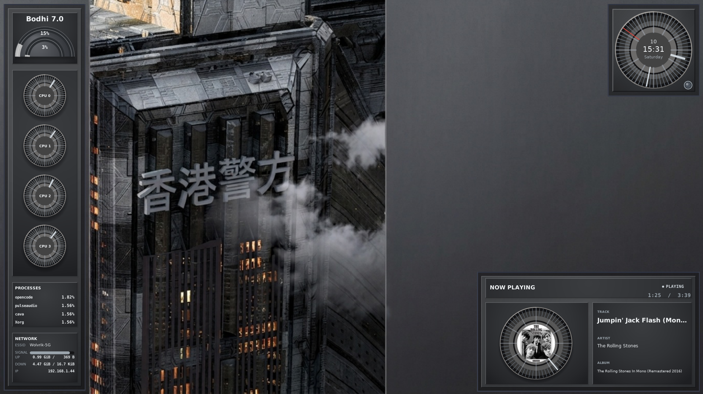
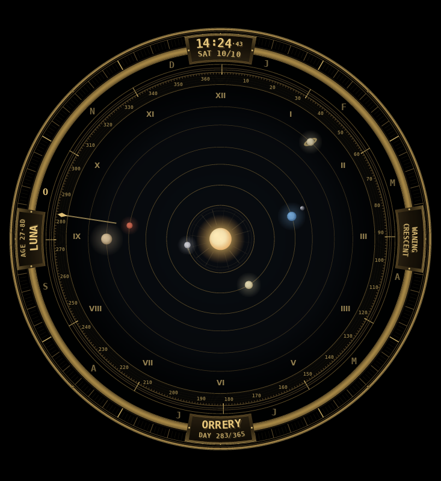
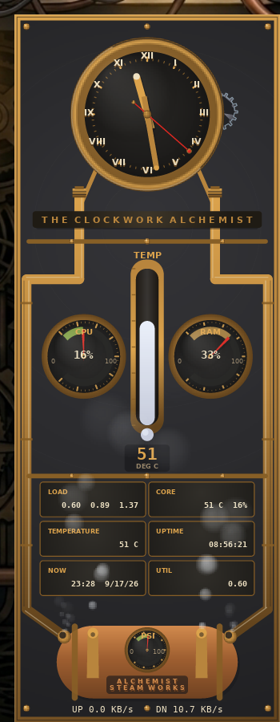
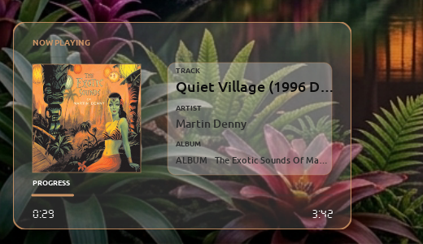
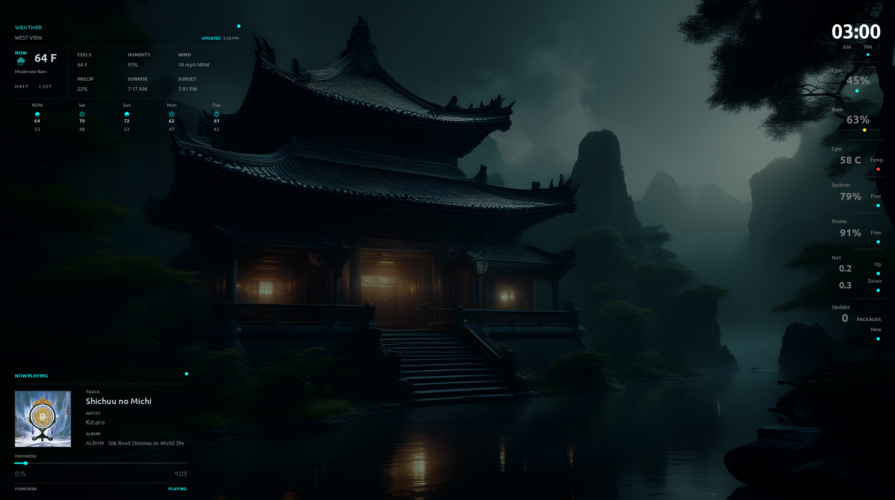
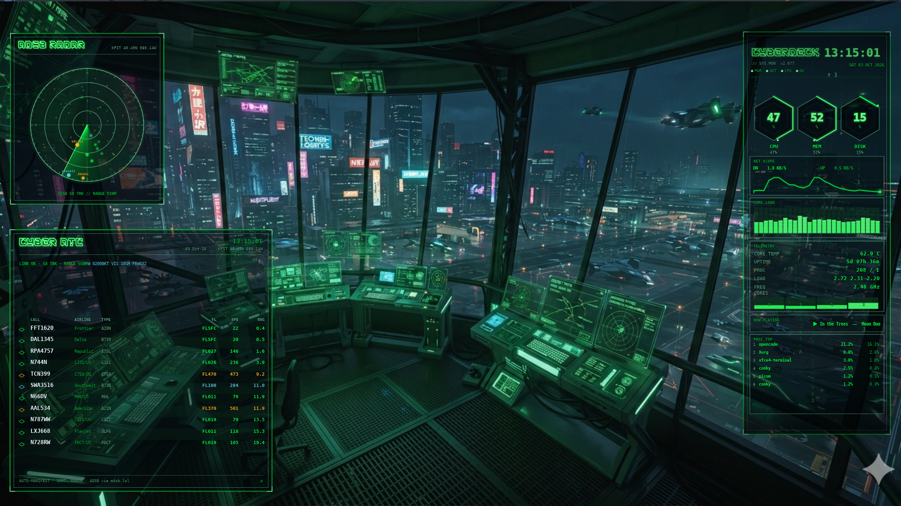
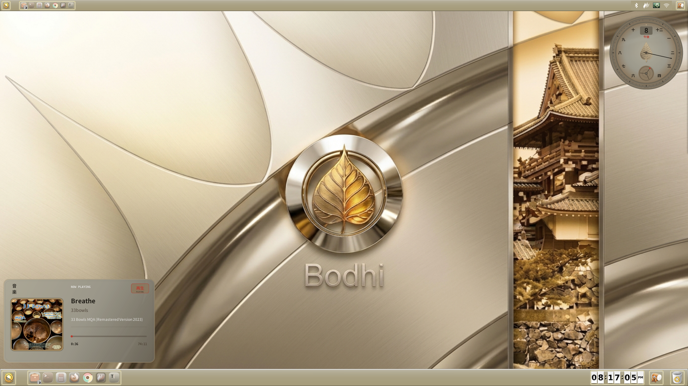

# Conky Configurations

A collection of handcrafted **Lua/Cairo** Conky themes (modern `conky.config = {...}` /
`conky.text = [[...]]` syntax, tested on **Conky 1.12.2**, Bodhi Linux / Moksha).
Free to use, modify, and share.

> Several of these were built together with AI assistants over many live-tuning
> sessions, from original community designs, and **four of the bundled
> wallpapers are AI-generated artwork**. Full per-file provenance — source
> designs, AI contributions, third-party fonts and artwork — is recorded in
> [`ATTRIBUTION.md`](ATTRIBUTION.md).

**Downloads:** themes that ship a ready-to-run package have a **zip download**
link in the table below (the zip lives inside that theme's folder).

## Themes

The themes are organised into **families** that share a visual language. The
**Metal** family is a cool black-metal gauge style; **Etched** is a minimal
Etched-style stat/player/weather set; **Cyber** is green-on-black terminal;
**Brass** is a round brass-instrument set on near-black. **Japan** is a Bodhi/Moksha
wallpaper-and-Conky collection with dark and light clocks and Pianobar panels.
**Classics** keep their original brand names.

| Theme | Family | Description |
| :--- | :--- | :--- |
| **metal-sysmon** | **Metal** | Full system monitor: title plate with ROOT/HOME half-ring gauges, 4 clock-style CPU speedometer dials with load %, PROCESSES, NETWORK. Cool black-metal finish. |
| **metal-clock** | **Metal** | The original jpope 2010 clock face with 12 long light-grey major ticks + 48 minors, hands emanating from the inner date/time/day circle. |
| **metal-pianobar** | **Metal** | Metal-gauge pianobar now-playing widget. Part of the **Metal** family, not a pianobar variant — it wears the same black-metal instrument styling as `metal-sysmon` and `metal-clock`. |
| **etched** | **Etched** | Etched-style stat column (clock, CPU/RAM/temps, disks, network) with an Ubuntu-font face. |
| **etched-pianobar** | **Etched** | Minimal pianobar card (cyan accents, no panel): track, artist, album, progress, state dots, album art. |
| **etched-weather** | **Etched** | Horizontal weather card: NOW panel + details grid + full-width 5-day forecast row. OpenWeather API. |
| **cyber-deck** | **Cyber** | Green-on-black cyberpunk terminal: hex CPU gauges, NET.SCOPE, telemetry, core bars, now-playing marquee, top processes. |
| **cyber-radar** | **Cyber** | Standalone ADS-B radar scope reading the live `adsb_radar.py` daemon (feed: adsb.lol): rotating sweep, aircraft blips + callsigns. |
| **cyber-atc** | **Cyber** | Live flight manifest from the same ADS-B daemon: one row per aircraft (callsign, airline, type, altitude, speed, range), plus MIL / emergency badges and a live METAR strip. |
| **clockwidget** | Classics | Interactive analog clock + month calendar (click the LED to flip clock/calendar, auto-returns after 10 s). Original jpope 2010 face, modernised. |
| **clockwork-alchemist** | Classics | Steampunk wall clock: skeleton dial with gear train, brass steam pipes, copper boiler, PSI dial, thermometer, CPU/RAM gauges, six readout plaques. 100% procedural Cairo. |
| **bionic** | Classics | Classic "Steel Conky by Mucas V2.0" plate (243x887 artwork) with sector-ring gauges: CPU / MEM / WLAN / TIME / BATTERY / VOLUME. |
| **WindingRings** | Classics | Glass "Air Clock" + live date rule + now-playing line, with six alternating semicircle "winding" meters down the right edge (CPU / MEM / FS root + home / Wi-Fi speed + quality). A single-file modern reimplementation of londonali1010's 2009 Air Clock and Ring widgets. [**Download zip**](WindingRings/WindingRings-conky.zip) |
| **WindingRingsColor** | Classics | Full-screen colour-field take on WindingRings: glass "Air Clock", date rule and now-playing line, with six large alternating winding meters (CPU / MEM / FS root + home / Wi-Fi speed + quality). Adopts your [pywal](https://github.com/dylanaraps/pywal) accent colour. [**Download zip**](WindingRingsColor/WindingRingsColor-conky.zip) |
| **WindingRingsColorPianobar** | Classics | Companion pianobar panel in the same style: album art, track / artist / album, progress bar, elapsed / total and play state, on a 440x270 `bottom_left` dock. [**Download zip**](WindingRingsColorPianobar/WindingRingsColorPianobar-conky.zip) |
| **orrery-brass** | **Brass** | Mechanical solar-system clock: 3D tumbling orbit rings, planets riding the time (Mercury = seconds, Venus = minutes, Earth = hours, Mars = day-of-year), true lunar phase at Earth, calendar ring with month letters + date hand, HUD plaques. 100% procedural Cairo, brass on near-black. |
| **brass-sysmon** | **Brass** | Round brass system monitor: four clock-style speedometer dials (CPU / MEM / NET / TEMP) around a centre LOAD / NET strip, `MK.I` maker's mark. |
| **brass-lyrics** | **Brass** | Round brass lyrics display: karaoke-synced lyrics fetched live from LRCLIB, title/artist curved on the bezel, progress sweep, graceful fetching/offline fallbacks. |
| **brasspianobar** | **Brass** | Round brass now-playing widget for pianobar: album art in the well, track / artist / album, progress sweep, pause/play state. |
| **brassviz** | **Brass** | Round brass audio spectrum visualiser driven by CAVA: twelve radial bands, a live level rail and peak-hold markers. |
| **Japan** | **Japan** | Bodhi/Moksha wallpaper-and-Conky collection: five custom wallpapers with Edje variants, dark Jump Hour and light clocks, and matching dark/light Pianobar now-playing panels. [**Download zip**](Japan/Japan-conky.zip) |

> **Two notes on the WindingRings colour pair.** They are meant to own a whole
> screen: the clock and rings are a single full-screen `1920x1080` dock window
> pinned at the top-left, sized to the primary monitor. While they run, clicks on
> the main screen land on the Conky window instead of what is behind it — treat it
> as a dedicated dashboard screen (or shrink `minimum_width`/`minimum_height` in
> the `.conf` to suit your layout). Both are **X11 only**; they will not work under
> Wayland. If you use **pywal**, they read `~/.cache/wal/colors.json` and adopt
> your current accent colour — which also means the palette you generate recolours
> your terminal emulators, an unexpected side effect the author ended up loving.

## Screenshots

Full-resolution captures — not downscaled. Where a family shares one visual
language, a single capture of the whole family running together is used in place
of separate per-theme shots. Captures for the remaining themes are still to do;
see [`ATTRIBUTION.md`](ATTRIBUTION.md) for credits.

### Metal family

metal-sysmon · metal-clock · metal-pianobar — all three together:



### Brass family

All five together:



### clockwork-alchemist



### bionic


### WindingRings


### WindingRingsColor · WindingRingsColorPianobar

Both running together over the bundled `ParisColorful.jpg` wallpaper (the second
shot is a crop of the pianobar panel in the bottom-left corner):




### etched · etched-pianobar · etched-weather

All three together:



### cyber-deck · cyber-radar · cyber-atc

All three together, running against the theme wallpaper:



### Japan

Main pairing from the collection, with five more full-resolution wallpaper/theme
examples in `Japan/screenshots/`:



## Installation

1. **Install dependencies** (Debian/Ubuntu/Mint):
   ```bash
   sudo apt install conky-all lua5.1 fonts-font-awesome
   ```
   A few themes need extra runtime deps (`pianobar`, `cava`, `pactl`, `python3`,
   ImageMagick `convert`, optional LuaSocket) or an API key. `bionic`,
   `clockwidget`, the three WindingRings themes and `Japan` ship a README of
   their own, so check a theme's files before assuming it runs standalone.
2. **Clone this repo**:
   ```bash
   git clone https://github.com/wolvrik-v1/conky-configs.git ~/conky-configs
   # install the ~/.conky-style themes (clocks, monitors, radar and the cyber deck)
   cp -r ~/conky-configs/{metal-sysmon,metal-clock,clockwidget,clockwork-alchemist,bionic,WindingRings,WindingRingsColor,WindingRingsColorPianobar,cyber-deck,cyber-radar,cyber-atc,etched,orrery-brass,brasspianobar,brassviz,brass-sysmon,brass-lyrics,Japan} ~/.conky/
   # install the ~/.config themes (pianobar players + weather API widget)
   cp -r ~/conky-configs/{metal-pianobar,etched-pianobar,etched-weather} ~/.config/
   ```
3. **Run a theme**: most ship a `./<name>` start/stop/restart wrapper, or launch with:
   ```bash
   conky -c ~/.conky/<theme>/<config>
   ```
   *(Tip: create a `.desktop` file in `~/.config/autostart/` to run on login.)*

## Updating this repo (after editing a widget)

```bash
cd ~/conky-configs
./sync.sh --apply    # pull changes from the live widget dirs into the tree
git add .
git commit -m "Update: ..."
git push
```

`sync.sh` only copies the curated widgets from their live install dirs
(`~/.conky`, `~/.config`) into this staging tree — it never deletes anything
live. Runtime logs, backups, session state and API keys are always excluded.

## Fonts

Themes need their bundled `fonts/` installed system-wide or placed in
`~/.local/share/fonts/` and refreshed with `fc-cache -fv`.

Fonts used across the set:

| Font | Status |
| --- | --- |
| **Ubuntu** | bundled — © 2010 Canonical Ltd., [Ubuntu Font Licence 1.0](etched/fonts/LICENSE-UFL-1.0.txt) |
| **HOOGE 05_54/53** | **not bundled** — no redistribution grant. Needed by `bionic`; get it from <https://www.dafont.com/craig-kroeger.d840> |
| **DejaVu Sans** | ships with most Linux distros; used by `Japan` |
| **DejaVu Sans Mono** | ships with most Linux distros; used by `Japan` |
| **Noto Sans CJK JP** | **not bundled** — install from your distro (for example `fonts-noto-cjk`) if the Japanese glyphs in `Japan` are missing |
| **DS-Digital** | **not bundled** — shareware, no redistribution grant. Needed by `WindingRingsColorPianobar` for its elapsed/total digits; get it from <https://www.dafont.com/ds-digital.font> |
| **Santana** | **not bundled** — freeware, no redistribution grant. Needed by `WindingRings` and `WindingRingsColor` for the date line; get it from <https://www.dafont.com/santana.font> |

Nothing breaks if a font is missing: the widgets reference fonts by family name
and fontconfig substitutes a default face. See
[`etched/fonts/README.md`](etched/fonts/README.md) and
[`bionic/fonts/README.md`](bionic/fonts/README.md) for the full details,
including the family-name check to run after installing HOOGE.

## Support

Consider starring ⭐ this repo if you find something useful here.